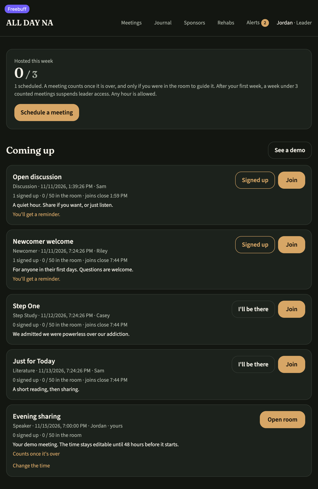
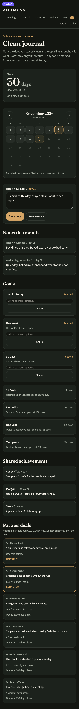
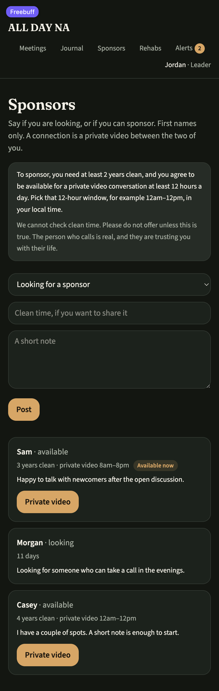
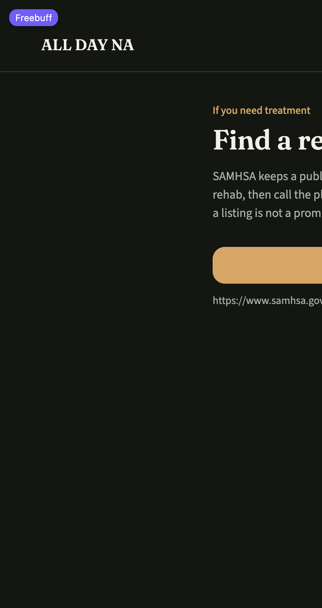

# ALL DAY NA

**Virtual Narcotics Anonymous meetings, any hour of the day.**

ALL DAY NA is a peer-led meeting space for people in Narcotics Anonymous and
anyone exploring recovery. Leaders schedule and guide meetings, attendees join
video rooms, and members keep a clean-day journal, connect with sponsors, and
look up treatment options.

> ALL DAY NA is an independent tool. It is not affiliated with, endorsed by, or
> operated by Narcotics Anonymous World Services (NAWS).



## First-run flow

1. Create an account with an email address and password.
2. Enter the 6-digit code sent to that email.
3. Accept the terms of use.
4. Choose the name other people will see and optionally add a clean date.
5. Pick Leader, Sponsor, both, or just attendee.

Someone who enters no clean time can still attend or lead, but cannot become a
sponsor. Sponsor access requires at least 2 years clean, enforced on the server.
The terms screen currently contains a plain-language draft; replace it with your
final policy before launch.

## Features

### Meetings and video rooms

- Leaders schedule meetings at any hour, choose a format (Discussion, Speaker,
  Step Study, Literature, or Newcomer). Every meeting is one hour long.
- Attendees can sign up for a reminder or join directly from the board.
- Rooms hold **50 people**. Joining closes **20 minutes after the scheduled
  start**; anyone who joined before the lock keeps access afterwards.
- A leader can always open their own room, even after the join lock.
- Rooms include camera and microphone controls, a live participant list, and
  chat. Presence is tracked with heartbeats, so the room count stays current.
- Ended meetings close automatically, and full rooms keep checking for a freed
  seat.

### Leader accountability

- Leaders are expected to guide at least **3 meetings per week**.
- After their first week, a week with fewer than 3 counted meetings suspends
  leader access. Suspended leaders can still attend every meeting.
- A meeting counts only after it ends, and only if the leader was in the room to
  guide it.
- Meeting times can only be changed **at least 48 hours** before the start.

### Clean-day journal

- Set a clean date and see the running day count.
- Mark any day between the clean date and today on a month calendar, with an
  optional note for each day.
- Track milestone chips and share an achievement to the community board once
  it is reached.
- Move between months while keeping every marked day and note.

### Sponsors

- Post a "seeking" or "offering" entry on the sponsor board.
- Sponsors offering their time confirm **at least 2 years clean** and choose a
  **12-hour daily availability window** in their local time.
- An "Available now" badge shows when someone's window is open.
- A connection opens a private two-person video room.
- Clean time is self-reported and cannot be verified by the app. The board asks
  people to be honest about it.

### Alerts and help

- In-app notifications for signups and meeting activity, with an unread badge.
- Browser notifications when permission is granted and the tab is in the
  background.
- A treatment locator page linking to
  [SAMHSA's find-help locators](https://www.samhsa.gov/find-help/locators).

## Tech stack

| Area    | Choice                                                        |
| ------- | ------------------------------------------------------------- |
| UI      | React 19, TanStack Start and TanStack Router, Tailwind CSS v4 |
| Build   | Vite 8, Nitro (Vercel preset)                                 |
| Data    | PostgreSQL via `pg` (Neon-compatible), or PGlite fallback     |
| Auth    | Better Auth                                                   |
| Tests   | Node's built-in test runner                                   |
| Quality | TypeScript, ESLint, Prettier, GitHub Actions                  |

## Getting started

### Requirements

- Node.js 22.12 or newer (CI uses Node 24)
- npm

### Run locally

```bash
npm install
npm run dev
```

Open <http://localhost:8080>. The dev server binds to `0.0.0.0:8080` so the live
preview can reach it.

On an empty database, click **See a demo** on the meeting board to seed a demo
profile and sample meetings. With no `RESEND_API_KEY` in local development, the
verification code is printed in the server log and shown on screen.

### Configuration

| Variable            | Required   | Purpose                                                                                                                            |
| ------------------- | ---------- | ---------------------------------------------------------------------------------------------------------------------------------- |
| `DATABASE_URL`      | No         | Postgres connection string. Without it the app uses an in-memory PGlite database, which resets when the server restarts.           |
| `VITE_AUTH_ENABLED` | No         | `"true"` (the default) requires sign-in. Set `"false"` only for a local demo user with no auth.                                    |
| `RESEND_API_KEY`    | Production | Sends the 6-digit verification email. Without it, local development logs the code and shows it on the verification screen instead. |
| `EMAIL_FROM`        | No         | Verified sender for Resend, for example `ALL DAY NA <hello@yourdomain.com>`. Defaults to Resend's onboarding sender.               |

Never commit credentials. For local development, put them in `.env.local`
(ignored by Git); the `dev`, `build`, `preview`, and `db:migrate` scripts load
that file automatically. In production, set them in the hosting provider's
environment settings.

With `DATABASE_URL` set, apply the schema once:

```bash
npm run db:migrate
```

The production build also runs the migrator when `DATABASE_URL` is present.

## Scripts

| Command              | What it does                                                      |
| -------------------- | ----------------------------------------------------------------- |
| `npm run dev`        | Start the Vite dev server on `0.0.0.0:8080`                       |
| `npm run build`      | Build for production and apply pending migrations when configured |
| `npm run preview`    | Serve the built output at `127.0.0.1:8081`                        |
| `npm test`           | Run the script and TypeScript test suites                         |
| `npm run typecheck`  | Type-check with `tsc --noEmit`                                    |
| `npm run lint`       | Lint the project with ESLint                                      |
| `npm run db:migrate` | Apply pending SQL migrations                                      |
| `npm run format`     | Format the project with Prettier                                  |

## How the rules are enforced

The room rules live in [`src/lib/room-access.ts`](src/lib/room-access.ts) and are
applied server-side, not just hidden in the UI:

| Rule                 | Behavior                                          |
| -------------------- | ------------------------------------------------- |
| Capacity             | 50 people in a room                               |
| Join lock            | No new joins 20 minutes after the scheduled start |
| Returning attendees  | Anyone who joined before the lock keeps access    |
| Leaders              | Can always open their own room                    |
| Ended meetings       | Closed to everyone                                |
| Rescheduling         | At least 48 hours before the start                |
| Leader participation | 3 guided meetings per week after the first week   |

[`src/lib/room-access.test.ts`](src/lib/room-access.test.ts) covers the capacity
and lock boundaries with an injectable clock.

## Project structure

```text
.
├── .github/workflows/ci.yml   # tests, typecheck, lint, and production build
├── migrations/                # SQL schema, applied in filename order
├── public/                    # icons, share card, and static assets
├── scripts/                   # PWA plugin, migration runner, checks
├── server/                    # server middleware (PWA and manifest)
├── src/
│   ├── components/            # shared UI, meeting room, header
│   ├── lib/
│   │   ├── auth/              # Better Auth client and server middleware
│   │   ├── meetings.functions.ts
│   │   ├── journal.functions.ts
│   │   ├── notify.functions.ts
│   │   └── room-access.ts
│   ├── routes/                # file-based pages
│   ├── router.tsx
│   └── styles.css
├── package.json
└── vite.config.ts
```

## Testing and CI

Run the same checks locally that CI runs:

```bash
npm test
npm run typecheck
npm run lint
npm run build
```

[`.github/workflows/ci.yml`](.github/workflows/ci.yml) runs all four on every
push and pull request using Node 24. The build step is safe without a database:
the migrator logs that it is skipping, while CI still verifies the production
bundle.

## Deployment

The Vite build uses Nitro's Vercel preset, so `npm run build` produces the
`.vercel/output` bundle. Deploy through Vercel's Git integration or run
`vercel deploy` from the project root so Vercel builds on its Linux builders.
Do not upload a `.vercel/output` built on an Apple Silicon Mac with
`vercel deploy --prebuilt`: prebuilt uploads can pull the macOS-only Rolldown
native binding into the deployment, where it hits Vercel's per-file upload
limit. If you need a prebuilt deployment, run the build in Linux CI first.

Configure the following in the hosting environment:

- `DATABASE_URL` for durable data. Without it, a deployed app falls back to
  in-memory PGlite and data will not survive.
- `RESEND_API_KEY` and a verified `EMAIL_FROM` so sign-up verification emails
  can be delivered.
- The auth provider credentials used by Better Auth.

Local HTTP development uses a bearer session token because Chromium rejects
`__Host-` Secure cookies on plain loopback origins. Deployed HTTPS uses the
normal Secure session cookie.

## Screenshots

| Journal                                                 | Sponsors                                      |
| ------------------------------------------------------- | --------------------------------------------- |
|  |  |



## Disclaimer

ALL DAY NA is an independent recovery tool, not a treatment provider or crisis
service. Meeting content is peer-led. If you are in immediate danger, contact
local emergency services.
